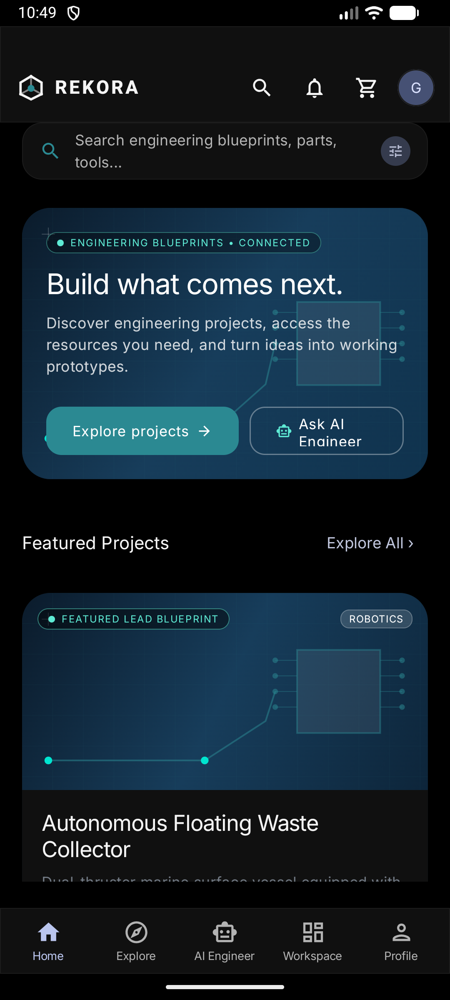
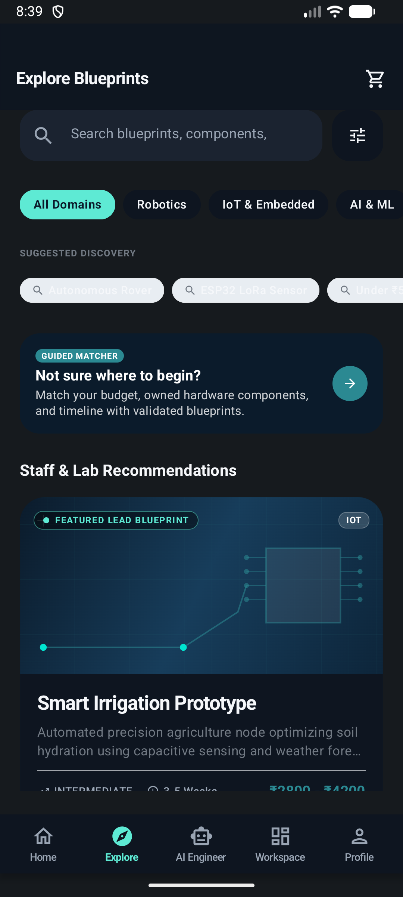
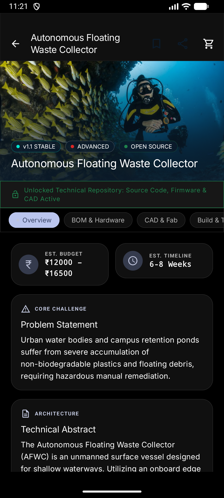
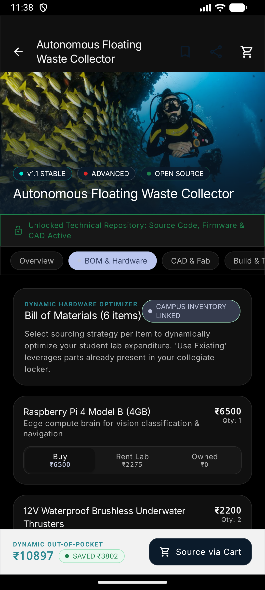
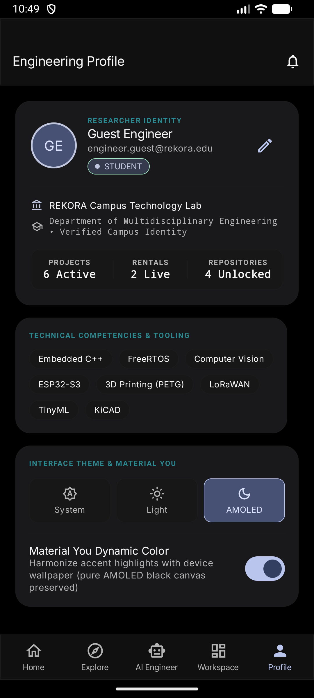
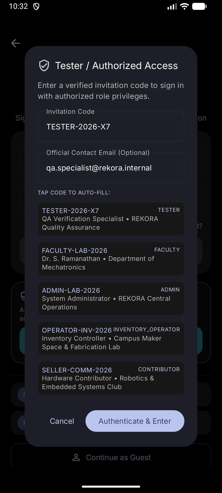

# REKORA — Engineering Projects. Connected.

<p align="center">
  <strong>From Idea to Prototype. From Prototype to Evolution.</strong>
</p>

<p align="center">
  <a href="https://developer.android.com"></a>
  <a href="https://kotlinlang.org"></a>
  <a href="https://developer.android.com/jetpack/compose"></a>
  <a href="https://m3.material.io"></a>
  <a href="https://developer.android.com/training/data-storage/room"></a>
  <a href="https://dagger.dev/hilt"></a>
  <a href="https://github.com/Nandhu2036/REKORA/actions"></a>
  <a href="https://github.com/Nandhu2036/REKORA/blob/main/LICENSE"></a>
</p>

---

## 1. Executive Summary & Vision

In contemporary collegiate engineering education, student hardware and software capstones suffer from structural lifecycle fragmentation:

1. **Redundant Hardware Expenditure:** Students repeatedly buy expensive sensors, microcontrollers, and communication shields at retail prices only to abandon them in drawers after end-of-semester evaluation.
2. **Loss of Intellectual & Technical Capital:** Project circuit schematics, calibration parameters, codebases, and CAD models vanish once grades are submitted, preventing progressive accumulation of knowledge.
3. **Fabrication & Sourcing Bottlenecks:** Bridging from digital CAD models to physical prototypes is stalled by fragmented part procurement, high shipping lead times, and uncoordinated campus maker lab access.
4. **Zero Longitudinal Continuity:** Each incoming batch repeats basic hobbyist prototypes from scratch rather than evolving previous cohorts' proven work into patentable, enterprise-grade innovations.

**REKORA** solves this by establishing a unified digital-and-physical platform connecting the entire academic prototyping lifecycle:

$$\textbf{Discover} \longrightarrow \textbf{Design} \longrightarrow \textbf{Source} \longrightarrow \textbf{Fabricate} \longrightarrow \textbf{Build} \longrightarrow \textbf{Test} \longrightarrow \textbf{Document} \longrightarrow \textbf{Preserve} \longrightarrow \textbf{Evolve}$$

---

## 2. Platform Architecture & Visual Showcase

### True AMOLED Material 3 Interface & Design Language
REKORA features a custom-engineered **True AMOLED** design system (`#000000` canvas, `#101010`/`#171717` elevated tonal surfaces, `#292929` borders, and high-legibility `#F5F5F5` Inter typography) optimized for battery efficiency on OLED displays and prolonged laboratory sessions.

| 01. True AMOLED Home Feed | 02. Multi-Criteria Explorer | 03. Comprehensive Hardware Specs |
|:---:|:---:|:---:|
|  |  |  |
| *Real-time student dashboard, stats, and quick actions* | *Domain filtering, budget constraints & search* | *System architecture, pinouts & CAD models* |

| 04. Dynamic Hardware BOM Optimizer | 05. Authenticated Profile & Lab State | 06. Authorized Tester Instant Portal |
|:---:|:---:|:---:|
|  |  |  |
| *Interactive Buy / Rent / Owned logic & deposit segregation* | *Department tags, active rentals & print jobs* | *One-tap credential loader for external evaluation* |

---

## 3. Key Engineering Features

### ⚡ Dynamic Hardware Bill of Materials (BOM) Optimizer
- **Intelligent Sourcing Modes:** Allows students to mark individual components as **Buy**, **Rent**, or **Already Owned**.
- **Real-Time Financial Recalculation:** Dynamically updates out-of-pocket costs, projected student savings, and refundable security deposits in real time.
- **Deposit Segregation:** Separates hardware rental deposits from transaction totals to ensure transparent campus lab auditing and refund guarantees.

### 🧠 AI Project Engineer & Blueprint Generator
- Conversational engineering consultant tailored to college constraints (budget, timeline, component availability, and engineering department).
- Generates structured engineering blueprints, component trade-off matrices, and circuit wiring recommendations.
- Local fallback logic ensures full functionality even under restricted campus internet environments.

### 🖨️ Campus 3D Printing & Fabrication Pipeline
- Direct quotation and intake pipeline for STL, STEP, and 3MF files.
- Automated material selection (PLA, PETG, ABS, Resin), infill density optimization, and lead-time estimation tailored to campus maker spaces.

### 🔄 P2P Resource Marketplace & QR Lifecycle Tracking
- Senior-to-junior peer marketplace for second-hand testing tools, developer boards, and sensors.
- Integrated CameraX + Google ML Kit barcode scanner for verifying physical inventory tags (`RK-ESP32-001`, `RK-LIDAR-004`).

### 🛡️ Production Cryptography & Role-Based Access Control (RBAC)
- **Zero Plaintext Passwords:** Secure password hashing using PBKDF2/SHA-256 with 16-byte cryptographically secure random salts.
- **Timing-Attack Resilient:** Constant-time verification protecting against side-channel analysis.
- **Role Permissions:** Granular access boundaries separating `STUDENT`, `FACULTY`, `LAB_OPERATOR`, and `ADMIN` tiers.

---

## 4. Software Architecture & Clean MVVM Pattern

```
┌────────────────────────────────────────────────────────────────────────┐
│                        PRESENTATION LAYER                              │
│       Jetpack Compose (Material 3 AMOLED) + Navigation Host            │
│       ViewModels (StateFlow, Unidirectional Data Flow, Inter Font)     │
├────────────────────────────────────────────────────────────────────────┤
│                           DOMAIN LAYER                                 │
│       Use Cases, Business Models, Algorithmic Matching Engine,         │
│       Financial Aggregators, Cryptographic Security Utilities          │
├────────────────────────────────────────────────────────────────────────┤
│                            DATA LAYER                                  │
│       Room Database (16 Entities, 13 DAOs) + Flow Coroutine Stream     │
│       DataStore Encrypted Session Storage + SeedDataProvider           │
│       Retrofit / OkHttp Networking Client + CameraX Barcode Scanner    │
└────────────────────────────────────────────────────────────────────────┘
```

### Complete Room Entity Schema
The local database engine operates 16 structured tables ensuring full offline usability:
- `users` — Student identity, department, semester, skills, verified status.
- `projects` — Multidisciplinary project catalog, budget brackets, CAD flags, repositories.
- `project_versions` — Project DNA lineage tracking version forks and hardware revisions.
- `components` — Institutional component inventory, rental rates, stock count, campus racks.
- `bom_items` — Per-project bill of materials with dynamic sourcing preferences.
- `cart_items` — Cart staging with separate rental days and deposit calculation.
- `orders` & `order_items` — Purchase and rental ledger with payment status tracking.
- `rentals` — Active rental contracts, QR item assignments, return dates, damage logs.
- `fabrication_jobs` — 3D printing orders, slicing parameters, infill %, campus fulfillment.
- `marketplace_listings` — Peer-to-peer campus hardware listings.
- `ai_conversations` & `ai_messages` — AI engineering blueprints and technical chat history.
- `notifications` — System and lab pickup alerts.
- `saved_projects` — Bookmarked engineering architectures.
- `inventory_items` — Physical serial numbers, QR codes, and maintenance records.

---

## 5. Technology Stack

| Component | Library / Framework | Version | Purpose |
|---|---|---|---|
| **Language** | Kotlin | `2.1.0` | Modern, null-safe native Android development |
| **UI Engine** | Jetpack Compose | BOM `2024.12.01` | Declarative UI with hardware-accelerated rendering |
| **Design System** | Material 3 + True AMOLED | Custom Tokens | High contrast, zero light bleed, battery efficient |
| **Typography** | Inter Font Family | Bundled TTF | Tabular figures (`tnum`) for technical alignment |
| **Dependency Injection** | Dagger Hilt | `2.53.1` | Clean decoupling and testability |
| **Persistence** | AndroidX Room | `2.6.1` | Embedded SQLite with reactive Coroutines Flow |
| **Preferences** | AndroidX DataStore | `1.1.1` | Asynchronous key-value session persistence |
| **Networking** | Retrofit + OkHttp3 | `2.11.0` / `4.12.0` | Type-safe REST client with logging interceptor |
| **Computer Vision** | CameraX + Google ML Kit | `1.4.1` / `17.3.0` | High-speed on-device barcode/QR scanning |
| **Minification / R8** | ProGuard / R8 | Native | Shrinks APK from 45.0 MB to **24.8 MB** |

---

## 6. How to Build & Run

### Prerequisites
- **Android Studio:** Ladybug (2024.2.1) or newer
- **Java SDK:** JDK 17 (Azul Zulu, Eclipse Temurin, or OpenJDK 17)
- **Android SDK:** Platform 35 (Android 15), Build-Tools 35.0.0
- **Min SDK:** Android 8.0 (API 26)

### Compilation Commands
```bash
# Navigate to the Android application module
cd app

# Execute all unit tests
./gradlew test

# Assemble debug APK for emulator testing
./gradlew assembleDebug

# Assemble optimized, R8-minified signed release APK
./gradlew assembleRelease
```

### Pre-Configured Test Accounts (Demonstration Access)
To verify different user roles instantly without manual registration, tap **"Authorized Tester Access"** on the login screen or use the following credentials:

| Role | Email | Password | Access Capabilities |
|---|---|---|---|
| **Engineering Student** | `student@rekora.edu` | `Rekora@2026` | Browse projects, optimize BOMs, request 3D prints, peer exchange |
| **Lab Administrator** | `admin@rekora.edu` | `Rekora@2026` | Inspect QR inventory, manage fabrication queues, approve rentals |
| **Faculty Mentor** | `faculty@rekora.edu` | `Rekora@2026` | Review project documentation, evaluate schematics & evolution |

---

## 7. Quality Assurance & Verification

REKORA includes unit and integration tests verifying critical financial and algorithmic paths:
- **`PriceCalculatorTest`:** Verifies dynamic BOM totaling, accurate deduction of student-owned components, and mathematical segregation of security deposits.
- **`ProjectMatcherTest`:** Tests multi-criteria ranking, explainable match scores (0–100%), budget threshold bounds, and timeline feasibility algorithms.
- **`SecurityUtilsTest`:** Tests SHA-256 password salting, unique salt generation, and constant-time string comparison against timing attacks.

```
> Task :app:testReleaseUnitTest
[PriceCalculatorTest] testDynamicBOMRecalculationWithOwnedItems ... PASSED
[PriceCalculatorTest] testRentalDepositSegregationCalculation ... PASSED
[ProjectMatcherTest] testProjectMatcherExplainsScoreAccurately ... PASSED
[SecurityUtilsTest] testPasswordHashGeneratesUniqueSalts ... PASSED
[SecurityUtilsTest] testConstantTimePasswordVerification ... PASSED

BUILD SUCCESSFUL in 3m 32s
```

---

## 8. Institutional Pilot Alignment

- **Lead Pilot Institution:** St. Joseph's College of Engineering, Chennai
- **Target Engineering Departments:**
  - Electronics & Communication Engineering (ECE)
  - Electrical & Electronics Engineering (EEE)
  - Mechanical Engineering & Mechatronics
  - Computer Science & Engineering (CSE)
  - Robotics & Automation
- **Seed Demonstrator Projects:**
  1. *Autonomous Floating Waste Collector* (Robotics/IoT/CV — ₹14,200)
  2. *Low-Cost Environmental Monitoring Station* (Solar/IoT — ₹3,800)
  3. *Smart Irrigation & Soil Telemetry Node* (Agritech/Sensors — ₹3,400)
  4. *Predictive Maintenance Vibration Sensor* (Edge AI/Vibration — ₹5,200)
  5. *3D-Printed Compliant Robotic Gripper* (Mechanical/Fabrication — ₹2,400)
  6. *Dual-Axis Solar Tracker with Telemetry* (Renewable Energy — ₹2,800)

---

## 9. Academic Integrity Charter

> [!IMPORTANT]
> **REKORA DOES NOT SELL READY-MADE PROJECT SUBMISSIONS OR HOMEWORK SOLUTIONS.**
> REKORA is strictly an educational prototyping infrastructure platform. It provides hardware access, component sharing, 3D printing pipelines, and structured technical documentation tools. The design verification, physical assembly, code implementation, experimentation, and academic viva defense remain the sole intellectual responsibility of the student.

---

## 10. License & Intellectual Property

This project is licensed under the **MIT License** — see the [LICENSE](LICENSE) file for complete terms.

```
Copyright (c) 2026 NandhaKumar G (Nandhu2036)
REKORA — Today's student project becomes tomorrow's institutional foundation.
```
