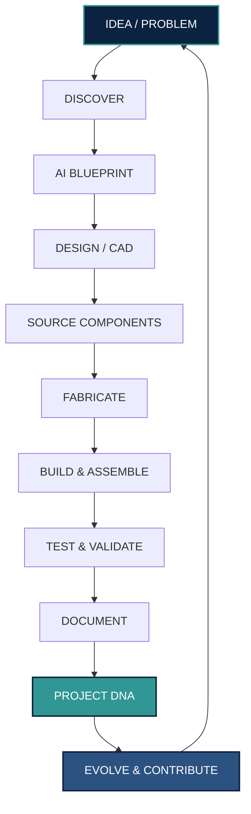
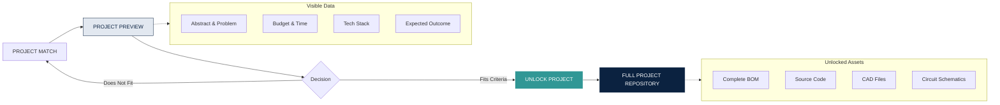
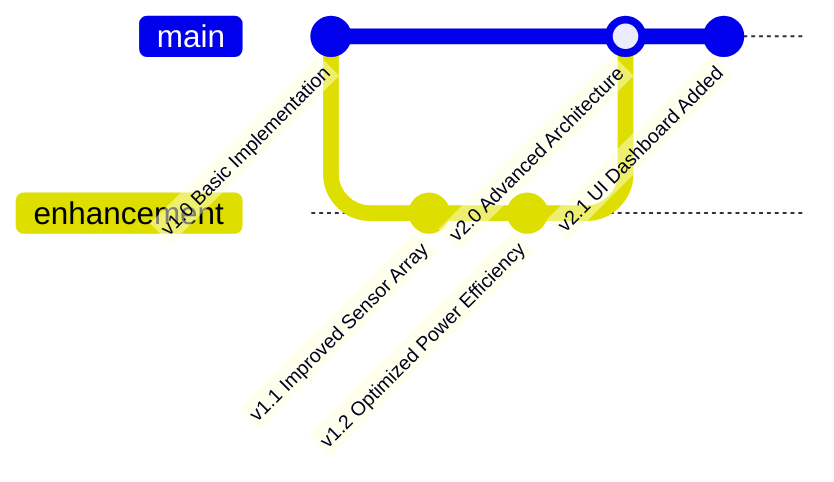
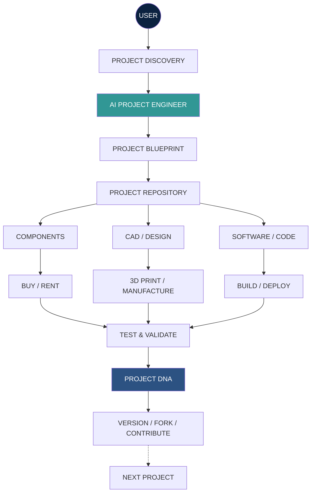
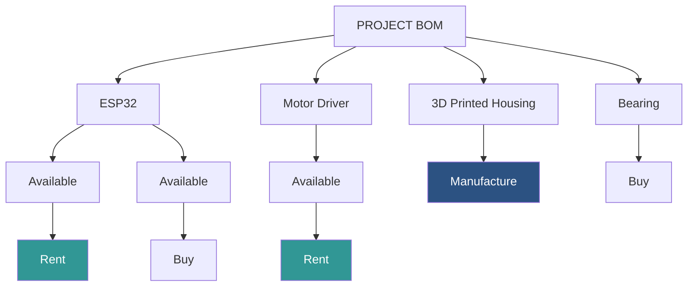
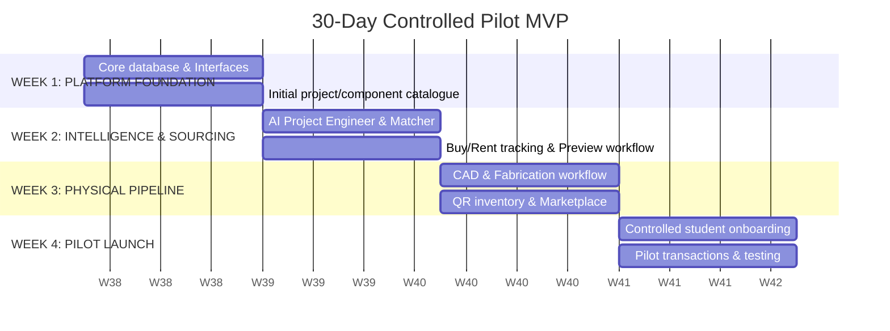

  <h1>REKORA</h1>
  <h3>From Idea to Prototype. From Prototype to Evolution.</h3>
    
  <h2>Project Proposal</h2>
    
  
<b>Submitted To:</b> 
  Dr. B. Babu Manoharan M.A., MBA., Ph.D 
  Chairman 
  St. Joseph's College of Engineering, Chennai

   
  
<b>Submitted By:</b> 
  Reshma S 
  Founder & CEO, REKORA 
  On behalf of the REKORA Founding Team

   
  
<b>Date:</b> 
  September 22, 2026

---

## 1. EXECUTIVE SUMMARY

The contemporary academic engineering landscape requires students to navigate a highly fragmented project lifecycle. A typical student must independently source ideas, procure expensive components, design digital models, and secure external fabrication services. Once a project is evaluated, the physical hardware is often discarded or shelved, and the engineering knowledge developed during the process is lost. This paradigm results in redundant hardware expenditure, underutilized institutional resources, and a complete lack of project continuity.

REKORA solves this inefficiency by introducing an integrated digital and physical engineering ecosystem. We connect project discovery, AI-assisted design, component sourcing, and campus-based fabrication into a single seamless workflow. Rather than forcing every student to start from zero, REKORA ensures that each completed project is archived with a unique "Project DNA." This digital repository preserves source code, 3D designs, bills of materials, and testing data, transforming past projects into foundational assets for future innovation.

To validate this model, we propose an initial controlled pilot at St. Joseph's College of Engineering. This college-first approach will introduce component rental to drastically lower student costs, alongside direct campus-based 3D printing and peer-to-peer resource exchange. We seek an initial seed allocation of ₹1,00,000–₹2,00,000 to establish the hardware inventory, tracking infrastructure, and MVP deployment. REKORA is designed not just as a platform, but as a cumulative engineering environment where today's student prototypes become tomorrow's institutional resources.

## 2. THE PROBLEM

### 2.1 Fragmented Project Lifecycle
A typical engineering student must independently navigate multiple disconnected phases to complete a single academic requirement. Ideation, component sourcing, CAD modification, manufacturing, and documentation exist in isolated silos, causing immense friction.

### 2.2 Repeated Hardware Expenditure
Students frequently purchase expensive components, microcontrollers, and full hardware kits that are only required temporarily for a single prototype. 

### 2.3 Scattered Engineering Resources
Sourcing ideas, modifying digital models, and finding reliable external fabrication services occur across disparate, often unreliable platforms with varying degrees of quality and support.

### 2.4 Loss of Project Knowledge
Once a project is evaluated and graded, the insights, troubleshooting steps, and design logic disappear. There is no centralized system to capture the intellectual output of student engineering efforts.

### 2.5 Limited Access to Fabrication
Moving from digital CAD to a physical prototype is a significant bottleneck. Students struggle with material selection, quotation, and locating accessible 3D printing or laser cutting facilities.

### 2.6 Lack of Project Continuity
Because prior work is inaccessible, subsequent cohorts are forced to build identical basic systems year after year, preventing the organic evolution of more complex and ambitious engineering solutions.

## 3. THE OPPORTUNITY

The current inefficiency represents a substantial opportunity to redefine academic engineering. By consolidating the fragmented components of project development into a unified platform, we can reduce the financial barrier to innovation while dramatically improving the quality of student output. 

There is an unprecedented opportunity to shift the paradigm from "disposable student projects" to "cumulative engineering assets." A platform that captures this value will not only serve students but will become an indispensable infrastructure layer for modern technical institutions.

## 4. REKORA — THE INTEGRATED ECOSYSTEM

REKORA is an integrated platform connecting the digital logic of project design with the physical realities of component sourcing and fabrication. It is designed to guide a project from conceptualization to physical realization, and finally to archival and evolution.

## 5. HOW REKORA WORKS

### 5.1 Project Discovery
A user may arrive at REKORA with a problem statement, a strict budget, a specific set of available components, or a domain interest. The REKORA Project Matcher algorithmically recommends suitable initiatives based on these parameters, ensuring viability.

### 5.2 AI Project Engineer
Acting as a technical consultant, the REKORA AI Project Engineer conducts a diagnostic conversation to clarify constraints, target users, and available campus inventory. It guides the student through critical engineering decisions.

### 5.3 Project Blueprint
The AI generates a structured Project Blueprint containing the proposed architecture, cost estimation, required components, fabrication needs, and a step-by-step development strategy.

### 5.4 Component Buy / Rent / Reuse
To reduce unnecessary purchases, REKORA integrates project BOMs directly with inventory availability. Students can choose to Buy, Rent, Use Existing, or Borrow components on an itemized basis.

### 5.5 CAD & Design
REKORA connects digital design to the physical build. Students can access, download, and customize standard 3D models, brackets, and housings directly aligned with their specific project requirements.

### 5.6 3D Printing & Fabrication
The ecosystem routes digital designs directly to physical manufacturing. Within the platform, students can request material selection, receive quotations, and seamlessly submit files for 3D printing or fabrication.

### 5.7 Build & Technical Support
During the physical assembly, REKORA provides structured integration instructions, calibration guides, and access to technical assistance for troubleshooting hardware and software bottlenecks.

### 5.8 Documentation
REKORA supports authentic project documentation by providing standardized frameworks for abstracts, methodologies, circuit diagrams, testing procedures, and final report structures.

### 5.9 Project Repository
A highly organized digital repository acts as the central hub for each project, securely housing all technical specifications, code, designs, and testing outcomes.

### 5.10 Project DNA
Every completed project receives a persistent digital identity—its "Project DNA"—preserving the precise configuration of hardware, software, and logic for future reference.

### 5.11 Project Evolution
Future users do not start from zero. They can access an existing Project DNA, fork the repository, modify the source code, improve the physical design, and contribute a new, advanced version back to the ecosystem.

### 5.12 Resource Marketplace
A peer-to-peer exchange where senior cohorts can list unused hardware, tools, and textbooks for juniors to purchase, rent, or borrow, fostering a circular academic economy.

## 6. PROJECT PREVIEW & UNLOCK MODEL

When a student discovers a project on REKORA, they are initially presented with a professional public preview. This ensures transparency and helps the student validate suitability without immediately exposing the complete underlying intellectual property.

### The Preview Answers:
*WHAT? WHY? WHO IS IT FOR? HOW DIFFICULT? WHAT DOES IT USE? WHAT WILL I GET?*

### The Unlocked Repository Answers:
*HOW EXACTLY?*

## 7. PROJECT REPOSITORY ARCHITECTURE

Once unlocked, the Project Repository provides a comprehensive, professionally structured environment for engineering execution.

1. **PROJECT OVERVIEW:** Abstract, Problem Statement, Objectives, Scope, System Architecture
2. **REQUIREMENTS:** Functional requirements, Technical requirements, Constraints
3. **HARDWARE:** Complete BOM, Component specifications, Datasheets, Wiring, Hardware configuration
4. **SOFTWARE:** Source code, Firmware, Algorithms, Dashboard/software resources
5. **CAD & DESIGN:** STEP files, STL files, CAD models, Engineering drawings, Design revisions
6. **FABRICATION:** Manufacturing instructions, Material selection, 3D printing requirements, Fabrication notes
7. **BUILD:** Assembly instructions, Integration, Calibration
8. **TESTING:** Test procedures, Test results, Validation, Known issues
9. **DOCUMENTATION:** Report framework, Diagrams, Presentation resources, Project records
10. **VERSION HISTORY:** Previous versions, Changes, Improvements, Contributors

> [!IMPORTANT]
> **REKORA DOES NOT SELL READY-MADE PROJECT SUBMISSIONS.** It supports the development and professional documentation of authentic student work. The academic implementation remains the responsibility of the student.

## 8. PROJECT DNA & VERSION EVOLUTION

The central philosophy of REKORA is that nothing valuable starts from zero. "Project DNA" is the persistent digital record of a completed build. Through REKORA, a basic prototype can organically evolve over multiple semesters into a sophisticated engineering solution.

A user who builds an existing project can contribute improved CAD files, lower-cost BOM alternatives, patched source code, or new testing data, pushing the ecosystem forward.

## 9. USER JOURNEY

**STEP 1:** Student arrives with an idea, problem, component set, or requirement.  
**STEP 2:** Project Matcher / AI Project Engineer helps identify a suitable project.  
**STEP 3:** Student opens the **PROJECT PREVIEW**.  
**STEP 4:** Student reviews Abstract, Problem, Objectives, Difficulty, Cost, Technology, and Expected outcome.  
**STEP 5:** Student chooses to **UNLOCK PROJECT**.  
**STEP 6:** Student receives access to the complete **PROJECT REPOSITORY**.  
**STEP 7:** The platform identifies Components required vs. Available vs. Rent vs. Purchase vs. Fabricate.  
**STEP 8:** Student designs/customizes CAD.  
**STEP 9:** Student orders fabrication / 3D printing.  
**STEP 10:** Student builds and tests.  
**STEP 11:** Student documents the project.  
**STEP 12:** Student can publish their implementation.  
**STEP 13:** Student can contribute improvements.  
**STEP 14:** Project evolves into a new version.

## 10. TECHNOLOGY & PLATFORM ARCHITECTURE

## 11. PHYSICAL RESOURCE ECOSYSTEM

### Digital → Physical Pipeline

### Component Sourcing Strategy

*Note: All physical inventory is managed via a QR-based lifecycle system (e.g., RK-ESP32-001) tracking usage history, maintenance, and rental condition.*

## 12. BUSINESS & REVENUE MODEL

REKORA establishes a diversified, sustainable revenue architecture that minimizes reliance on low-margin commodity sales.

### Initial Revenue Model
| Revenue Stream | Description |
| :--- | :--- |
| **Project Repository Access** | Users pay to unlock complete project resources where applicable. |
| **Component Rental** | Recurring utilization of physical inventory. |
| **Component Sales** | Margin on components and project kits. |
| **3D Printing** | Manufacturing/service margin. |
| **CAD & Design Services** | Paid design modifications and engineering assistance. |
| **Fabrication Services** | 3D printing, laser cutting, CNC or partner fabrication. |
| **Marketplace Commission** | Commission on peer-to-peer transactions. |

### Future Revenue Opportunities
| Revenue Stream | Description |
| :--- | :--- |
| **Technical Assistance** | Paid troubleshooting, mentoring and engineering support. |
| **Premium AI / Platform Features** | Potential future subscription model. |
| **Institutional Services** | College-level platform/inventory/project archive subscriptions. |
| **Future Industry Services** | Industry-sponsored projects, prototype development and engineering challenges. |

## 13. VALUE PROPOSITION

The platform creates value by eliminating friction. Students currently need to navigate disconnected services: Project discovery, Components, CAD, 3D printing, Code, Documentation, Technical support, Seniors, and Hardware reuse. REKORA integrates these around the project itself.

* **CONVENIENCE:** Students avoid searching across multiple platforms.
* **COST REDUCTION:** Rental/reuse can reduce unnecessary hardware purchases.
* **RESOURCE UTILIZATION:** Components can be reused across multiple projects.
* **KNOWLEDGE RETENTION:** Project DNA prevents valuable work from disappearing after submission.
* **ENGINEERING CONTINUITY:** Future users can improve previous projects.
* **FABRICATION ACCESS:** Students can move from digital design to physical prototype.
* **TECHNICAL GUIDANCE:** AI and human support help users navigate engineering decisions.

## 14. COMPETITIVE DIFFERENTIATION

The existing academic engineering market is fragmented across component marketplaces, 3D printing services, AI assistants, Git repositories, video tutorials, local project support, and senior networks. 

**Core Differentiator:** REKORA does not simply provide project information or components. It connects the engineering project's digital identity with the physical resources required to build, test, reuse and evolve it.

## 15. INITIAL COLLEGE PILOT

We propose **St. Joseph's College of Engineering, Chennai** as the INITIAL controlled pilot environment. The pilot objective is to rigorously validate:
* Student demand and willingness to pay
* Component rental utilization
* 3D printing demand
* Project repository usage
* AI usefulness
* Resource reuse
* Marketplace activity
* Operational feasibility

**Pilot Philosophy:** BUILD → VALIDATE → GENERATE REVENUE → REINVEST → EXPAND

## 16. 30-DAY CONTROLLED MVP

## 17. RESOURCE & BUDGET REQUIREMENTS

To execute the controlled campus pilot, we are seeking an **INITIAL SEED REQUIREMENT: ₹1,00,000 – ₹2,00,000**. Because the core software is developed internally, capital is strictly allocated to establishing physical infrastructure and inventory.

| Capital Allocation Area | Estimated Budget Range (INR) |
| :--- | :--- |
| **Initial Component Inventory** | ₹50,000 – ₹80,000 |
| **3D Printing & Fabrication** | ₹20,000 – ₹40,000 |
| **QR & Inventory Tracking** | ₹5,000 – ₹10,000 |
| **Cloud Hosting & Technical Services** | ₹5,000 – ₹10,000 |
| **Operations & Packaging** | ₹5,000 – ₹10,000 |
| **Marketing & Campus Launch** | ₹5,000 – ₹10,000 |
| **Contingency Reserve** | ₹10,000 – ₹20,000 |
| **Total** | **₹1,00,000 – ₹1,80,000** |

## 18. RISK & MITIGATION

1. **Low-margin commodity components** 
   *Mitigation:* Focus on integrated kits, rentals and services.
2. **Inventory capital lock-in** 
   *Mitigation:* Start with high-utilization components and controlled inventory.
3. **Hardware damage during rental** 
   *Mitigation:* QR lifecycle tracking, condition records, deposits and inspection.
4. **High technical-support demand** 
   *Mitigation:* Documentation, AI support, structured support tiers.
5. **Seasonal academic demand** 
   *Mitigation:* 3D printing, maker services, institutional contracts and broader engineering use cases.
6. **Academic-integrity concerns** 
   *Mitigation:* No ready-made submissions; focus on authentic project development.
7. **Intellectual-property issues** 
   *Mitigation:* Project ownership, contributor attribution, licensing and version records.
8. **Operational complexity** 
   *Mitigation:* Start with a controlled college pilot.
9. **Quality issues** 
   *Mitigation:* Verified project repositories and documented testing.
10. **Founder dependency** 
    *Mitigation:* Standardized workflows, documentation and role-based operations.

## 19. ACADEMIC INTEGRITY & RESPONSIBLE USE

REKORA does not exist to sell ready-made academic submissions. It exists to provide:
* Engineering resources
* Prototyping support
* Technical guidance
* Design assistance
* Hardware access
* Fabrication
* Documentation frameworks
* Knowledge sharing

The student's actual implementation, testing, understanding and academic responsibility remain their own. This strengthens institutional trust.

## 20. INSTITUTIONAL BENEFITS

**FOR THE INSTITUTION:**
* Centralized archive of student innovation
* Better utilization of physical resources
* Increased reuse of project hardware
* Structured project knowledge
* Support for project-based learning
* Visibility into project evolution
* Student innovation ecosystem
* Potential entrepreneurial ecosystem
* Reduced duplication of resources

**FOR STUDENTS:**
* Lower hardware acquisition burden
* Buy/rent/reuse flexibility
* Project discovery
* Technical assistance
* AI project guidance
* CAD support
* Fabrication access
* Structured project resources
* Knowledge from previous projects

**FOR FACULTY:**
* Better project visibility
* Structured project records
* Project blueprints
* Version history
* Organized documentation
* Potential visibility into recurring technical problems

## 21. LONG-TERM VISION

REKORA can evolve from a college pilot into an engineering innovation ecosystem connecting: STUDENTS, COLLEGES, MAKERS, RESEARCHERS, STARTUPS, and INDUSTRY.

Potential future capabilities:
* Multi-college project ecosystem
* Institutional project archives
* Advanced engineering marketplace
* Industry problem statements
* Sponsored challenges
* Prototype development
* Research collaboration
* Engineering talent discovery
* Broader fabrication network

## 22. FOUNDING TEAM

**Reshma S**
*Founder & CEO*
Vision, business strategy, institutional partnerships

**NandhaKumar G**
*Co-Founder, Tech & Fab*
Application development, 3D printing, fabrication integration

**Justin I**
*3D CAD & Product Design Lead*
3D modelling, design modification, prototyping architecture

**Rogith Kumar R**
*Co-Founder & COO*
Operations, execution, process management

**Monica S**
*Inventory Operations Manager*
Component lifecycle, stock management, QR procurement tracking

**Sanjay B**
*Design & Client Relations Lead*
Requirement gathering, student communication, college relations

## 23. IMPLEMENTATION & NEXT STEPS

We seek formal institutional approval to initiate the 30-day MVP build and controlled pilot deployment. Upon approval and capital allocation, the founding team will immediately commence the establishment of the platform infrastructure, inventory procurement, and fabrication workflows at St. Joseph's College of Engineering.

## 24. CONCLUSION

Supporting REKORA is not simply supporting another student project platform. 

It is an opportunity to establish a cumulative engineering ecosystem in which:
* **today's project** becomes tomorrow's resource,
* **today's prototype** becomes tomorrow's improved version, 
* and **today's engineering knowledge** becomes the foundation for future innovation.

REKORA seeks institutional approval and initial seed support of ₹1,00,000–₹2,00,000 to establish and validate the controlled campus pilot.
